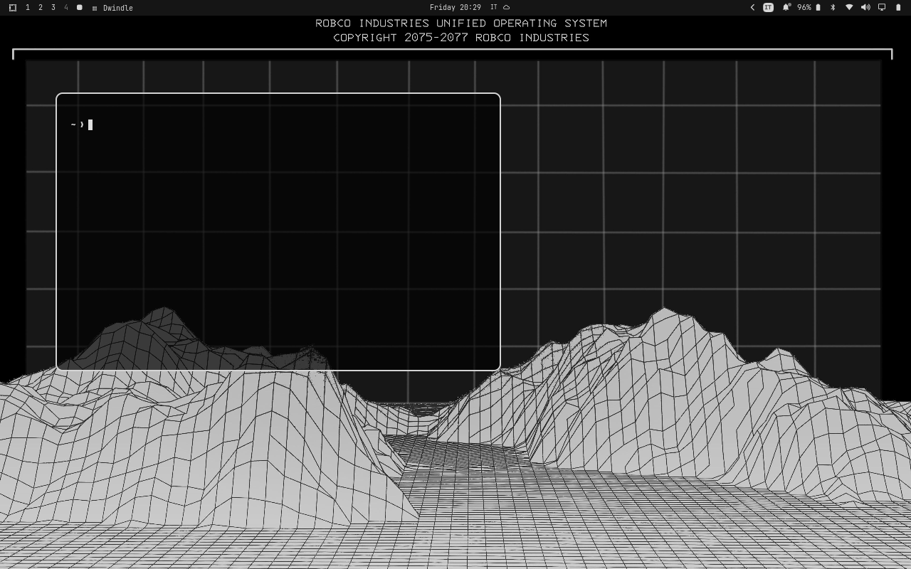
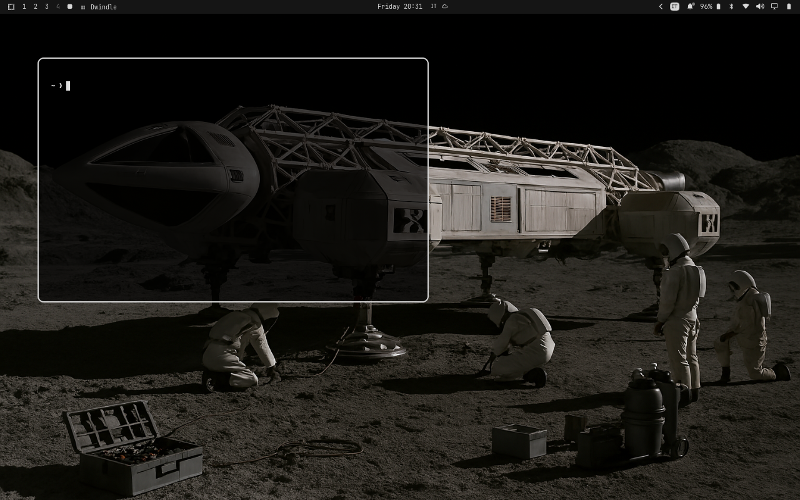
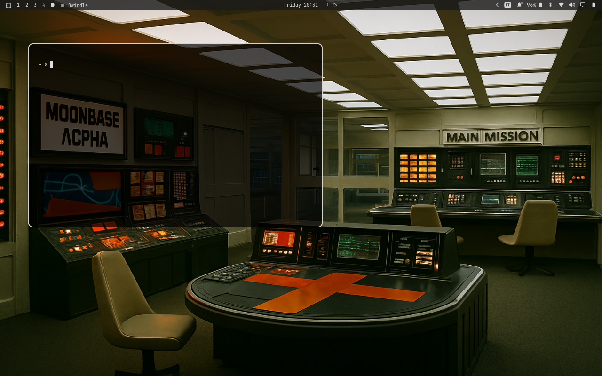

# Moonbase Alpha

Theme inspired by the TV show [Space 1999](https://www.imdb.com/title/tt0072564/) (1975–1977) and its retro sci-fi aesthetic.

For a subtle transparency effect in Kitty, add these lines to your `kitty.conf`:

```conf
background_opacity 0.7
cursor_trail 1
```

## Quick Install

```bash
omarchy-theme-install https://github.com/echoes1971/omarchy-moonbase-alpha-theme
```

## Screenshots






